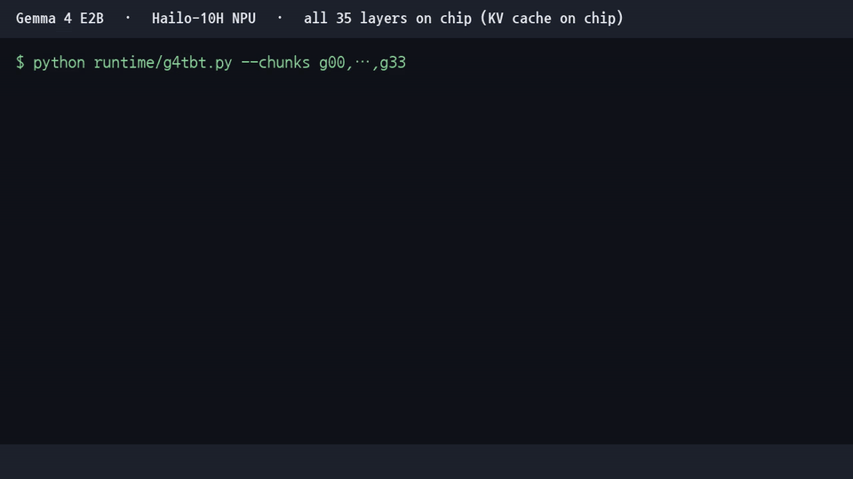

# Gemma 4 E2B on Hailo-10H

**An unofficial, from-scratch port of Google's Gemma 4 E2B (text) to the Hailo-10H NPU, with all 35 decoder layers running on the chip.**

Gemma 4 isn't in Hailo's model zoo, and Hailo's GenAI runtime (`hailort::genai::LLM`) only handles the Qwen-style pipelines it ships with. So this project builds every stage itself:

- **Graph:** converts the HF weights straight into a Hailo HN graph plus params. There's no ONNX step.
- **Quantization and compilation:** uses the Hailo DFC 5.4, including its on-chip KV-cache (`CACHE` IO) path.
- **Runtime:** a small Python runtime on HailoRT 5.4 chains 12 KV-cache network groups on the device, one per chunk.

> Status: **v0.1, experimental.** It works end-to-end, but it's slow. On the same box a CPU `llama.cpp` will probably beat it.
> The goal was "make it run", not "make it fast".



*Recorded on the device. Decoding is shown in real time; the one-time startup (8×) and the prompt (4×) are sped up and labeled. Full quality: [assets/demo.mp4](assets/demo.mp4).*

## Quick start (precompiled, no DFC needed)

Requirements: a Hailo-10H with the HailoRT **5.4.0** driver and firmware, plus the matching `hailort` Python wheel from the Hailo Developer Zone. You also need about 17 GB of free disk during install (HEFs 1.1 GB, the HF model, and 5.5 GB of host tables) and 8 GB of RAM.

```bash
git clone https://github.com/wishlist369/gemma4-hailo10h && cd gemma4-hailo10h
PY=/path/to/venv/bin/python ./install.sh ~/g4hailo   # downloads the HEFs (sha256 checked) and google/gemma-4-E2B-it, exports host tables
cd ~/g4hailo && /path/to/venv/bin/python g4chat.py   # about 26 s startup, then type prompts
```

`g4chat.py` keeps all 12 network groups resident and starts each prompt with a fresh KV cache, so every prompt is a single turn. Prompt plus answer is limited to 511 tokens. Use `--prompt "..."` for a one-shot run and `--temp 0.7` to sample instead of greedy decoding.

## Results (Hailo-10H, HailoRT 5.4.0, FW 5.4.0)

Example generation (greedy, Korean prompt "What's the capital of Korea? One sentence, plus one famous food"):

```
서울입니다. 유명한 음식으로는 비빔밥이 있습니다.
("It's Seoul. A famous food is bibimbap.")  — 14 tokens, stopped on EOS
```

### Accuracy

The model scores the next token at every position while being fed the reference continuation. The reference is HF bf16 greedy output. The benchmark is 24 prompts (Korean and English), 565 scored tokens.

| Runtime | top-1 match | top-5 match |
|---|---|---|
| **v0.1: KV cache on chip (this repo)** | **86.2%** (487/565) | **97.7%** (552/565) |
| Earlier prototype: no KV cache, recompute the whole context every token | 86.5% | 98.6% |

Moving to the on-chip KV cache cost essentially no accuracy. The remaining gap to bf16 comes from quantization (mostly a8/w4 projections and a16 residuals).

### Speed

| | value |
|---|---|
| Decode step on the NPU (35 layers, 12 network groups) | **435 ms/token, about 2.3 tokens/s** (median 434.8, p90 437.8) |
| End to end, including host lm_head and sampling | about 2.1 tokens/s (as in the demo) |
| Configure all 12 groups (they stay resident) | 26 s, once at startup |
| Prompt processing | 435 ms per prompt token (see limitations) |

Where the time goes:
- Each decoder block costs about 5.5–6 ms on the chip. This floor barely moves with compiler settings.
- Each network-group switch adds about 10–12 ms on top.
- Fewer, bigger groups would help. For example, 6-block groups would be about 3.6 tok/s on paper, but the DFC currently crashes compiling them (see below).

## Architecture

```
host (CPU, numpy only)                          Hailo-10H
──────────────────────                          ──────────────────────────────────────────────
tokenizer
token embedding ×√d   (bf16 table, 0.8 GB)
per-layer embeddings  (bf16 table, 4.7 GB)
  + PLE projection/norm
mask / RoPE cos·sin inputs        ──────►       g00: blocks 0-2  ─► g03: 3-5 ─► … ─► g33: 33-34
                                                each group = 3 decoder blocks, own KV cache (CACHE IO)
final norm + tied lm_head + softcap  ◄──────   last hidden
sampling
```

Which layers run where:
- **Hailo:** all 35 decoder layers. That covers sandwich RMSNorm, QK-norm, GQA 8q/1kv, GELU-tanh MLP, the double-wide MLP on KV-shared layers, the PLE gate, sliding (512) and full attention, and partial RoPE.
- **Host:** the lm_head runs on the host for now.

There are 12 chunks (`g00` … `g33`). Each is compiled to a single-group `tbt` (token-by-token) HEF. All 12 stay configured on the device at once.

## Things worth knowing if you do this yourself

The non-obvious findings are written up in [`docs/NOTES.md`](docs/NOTES.md). The short version:

1. **Several KV-cache HEFs on one VDevice need unique network names AND unique `cache_id` ranges.**
   - HailoRT's `CacheManager` keys caches by core-op (network) name and backing buffers globally by `cache_id`.
   - The DFC numbers `cache_id` from 0 in every HEF.
   - If two chunks reuse IDs with different sizes, configure fails with `Cache size mismatch`. Duplicate names fail with `NOT_FOUND`.
   - The fix is `compile/har_split_cid.py`. Set `NET_NAME` and `CACHE_OFF` when splitting.
2. **`update_cache_offset` is global to the VDevice.** Call it once per token on the first chunk, not once per chunk.
   - Calling it per chunk shifts every cache N times. A 2-chunk test dropped from cos 0.986 to 0.774 that way.
3. **Build the HN by hand from a reference HAR.** `convert/g4conv.py` writes the HN dict and params directly. It copies layer "templates" and naming conventions from Hailo's public Qwen2-1.5B HAR, because the optimizer groups some chains (for example the softmax decomposition) by name.
4. **The step time has a fixed floor of about 5.7 ms per decoder block.** Halving the number of contexts only saved about 8%.

## Repository layout

| dir | what | runs on |
|---|---|---|
| `convert/` | `g4conv.py`: HF → Hailo HN + params. `g4chunk.py`: per-chunk calibration data and HF reference. `g4export.py` / `g4export_np.py`: host tables (`_np` is torch-free and gives byte-identical output). `g4host.py`: torch reference preprocessing. `hf_bench.py`: builds the scoring benchmark | DFC machine (torch + transformers venv) |
| `quant/` | `chunk_quant.sh`, `p1_quant.py`: quantize one chunk with KV on. `kvq.sh` + `kv_list.txt`: the 12-chunk batch | DFC docker |
| `compile/` | `har_split_cid.py`: extract the tbt scope with a unique name and cache_id offset. `gsplit.sh` + `g_list.txt`: split batch. `gcomp.sh`, `p1_compile.py`, `compile_l0_u75.alls`: compile | DFC docker |
| `runtime/` | `g4chat.py`: interactive CLI. `g4tbt.py`: generate (debug flags). `g4tbt_score.py`: teacher-forced scoring. `g4rt_host.py`: host side. `hf_bench.json`: the benchmark | Hailo-10H host (HailoRT 5.4 Python) |
| `results/` | logs and JSON behind the numbers above | |

Code comments are mostly in Korean (it was a personal project). Paths are the ones from my setup (`/root/hailo/g4`, docker `/work2`, `/opt/g4`). Adjust them for yours.

## Reproducing

What you need:
- **DFC machine:** Hailo AI Software Suite docker with DFC 5.4 (`hailo_ai_sw_suite_2026-08`). Quantization peaks around 10–16 GB RAM per chunk. Compilation takes about 20–60 min per chunk on 4–8 cores.
- **Runtime host:** a Hailo-10H with HailoRT/FW 5.4.0. It needs about 5.5 GB of disk for the host tables, which are memory-mapped; an 8 GB / 4-core box was enough.
- **Model and reference files:** `google/gemma-4-E2B-it` from Hugging Face, and Hailo's public reference HAR `qwen2_1.5b_instruct.q.har` (you only need its `.hn`) from dev-public.hailo.ai.
- **Calibration text:** any long text in your target language goes in `calib_texts/*.md`. I used my own Korean notes, which aren't included.

Steps:
1. Quantize all 12 chunks with KV on:
   ```
   quant/kvq.sh quant/kv_list.txt
   ```
2. Split out the tbt scope with unique names and cache IDs:
   ```
   compile/gsplit.sh    # reads compile/g_list.txt
   ```
3. Compile each chunk:
   ```
   compile/gcomp.sh g00 g03 …
   ```
4. Export the host tables (`convert/g4export_np.py <model_dir> <host_dir>`) and copy them, plus the 12 `gNN_tbt.hef` + `gNN_meta.json`, to the runtime host.
5. Generate:
   ```
   python runtime/g4tbt.py --chunks g00,g03,g06,g09,g12,g15,g18,g21,g24,g27,g30,g33 --mode tbtonly
   ```
6. Score:
   ```
   python runtime/g4tbt_score.py --chunks … --bench runtime/hf_bench.json
   ```

Precompiled HEFs are attached to the GitHub Release (about 1.1 GB total). `install.sh` covers steps 4–5 with them.

## Known limitations / TODO

- **The prompt goes through the 1-token path.**
  - The prefill network group (96-token blocks) compiles and runs.
  - Handing its KV state over to the tbt group isn't solved yet. So the prompt is fed token by token: 35 tokens take about 15 s.
- **The DFC crashes on 6-block groups.** Fusing 6 blocks per group would cut group switches in half, but the DFC 5.4 allocator crashes deterministically on the final context.
- **`g4tbt.py` and `g4tbt_score.py` print errors at exit.** You get `Lost communication with the server …` spam because they don't close the configured models before the VDevice. It's harmless, and `g4chat.py` shuts down cleanly.
- **Context is capped at 512 tokens.** That's the cache size. Gemma's sliding window is also 512.
- **lm_head runs on the host CPU.**

## License

- **Code:** MIT.
- **Precompiled HEFs:** contain quantized Gemma 4 weights, licensed under Apache 2.0.
- **Hailo software:** not included.

See [NOTICE](NOTICE). This project isn't affiliated with Google or Hailo.

---

## 한국어 요약

Gemma 4 E2B(텍스트)를 Hailo-10H로 직접 포팅한 프로젝트야. 공식 모델 zoo에도 없고 공식 GenAI 런타임도 쓰지 않았어.

- **변환:** HF 가중치를 HN으로 직접 변환했어.
- **양자화·컴파일:** DFC 5.4의 온칩 KV 캐시 경로를 썼어.
- **런타임:** 12개 네트워크 그룹을 체인으로 묶는 자작 런타임이야.
- **결과:**
  - 35층 전부 칩에서 돌아.
  - 속도는 **약 2.3 tok/s**야.
  - HF 정답 대비 **top-1 86.2% / top-5 97.7%**야.
- **다중 KV HEF 동시 상주:** 핵심 함정 두 가지는 `docs/NOTES.md`에 정리했어.
  - 넷 이름과 cache_id 범위가 HEF마다 고유해야 해.
  - `update_cache_offset`은 토큰당 1회만 호출해야 해.
